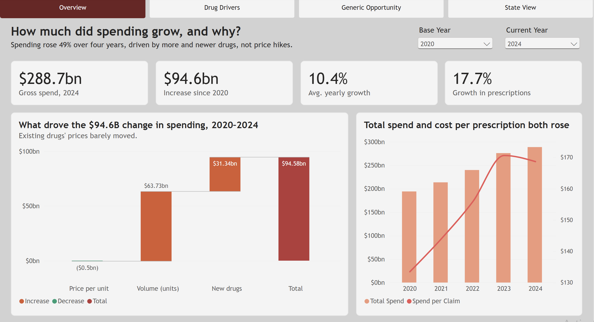

# What's Driving Medicare Part D Drug Spending? (2020-2024)

Power BI analysis of CMS Medicare Part D data to answer how much drug spending grew,
whether price or volume drove it, and how much generic substitution could save.

## Business questions
1. How much did Part D gross spending increase from 2020 to 2024, and was it price or volume?
2. Which drugs drove the growth?
3. How much could switching multi-source brands to generics save?
4. Which states lag on generic fill rates, and does it cost them?

## Key findings
- **Part D spending increased by 49%**, from $194.1B in 2020 to $288.7B in 2024, averaging an annual increase of 10.4%. Prescriptions grew by just 17.7% in the same period of time.
- **Price increases weren't the main reason for this increase.** Instead, of the $94.6B increase, higher prices on existing drugs actually had a slightly effect ($-0.5B). About 463.7B came from increased volume and changes in the drugs being used. Another $31.3B came from new drugs that came out after 2020.
- **A small number of drugs accounted for the most increase.** The top 10 drugs contributed $56.4B, roughly 60% of total spending growth. The biggest contributors were Ozempic, Eliquis, and Jardiance.
- **Ozempic is interesting** because its spending increased from $1.5B to $13.0B, increasing claims by 765%, but its spending per unit actually fell by 20%. The volume effect added $14.7B, while the price effect reduced spending by $3.2B. A **lot** more patients are using Ozempic in recent years, but it is also important to note different dosages can explain some of the decrease.
- **Generics account for most prescriptions but little spending.** They make up 87% of all fills but only 13% of spending. Brands with generic alternatives account for 12.4% of spending, while brand name drugs account for 74.9%.
- **There is room for generic drug substitution, but the savings depend on how much switching is realistic.** At a 50% substitution rate, the estimated annual savings are around $7.1B. The 25 drugs selected for Medicare price negotiation also represent a significant share of spending at 35.9%.
- **States with higher generic fill rates tend to have lower costs per fill.** Generic use ranged from 84.7% in DC (average $154 per 30-day fill) to 89.2% in Minnesota.

## Recommendations
1. **Drugs with generic alternatives is the first step to cutting costs/spend.** The top 15 multi-source brands represent around $3.8B in potential annual savings at a 50% switch rate. Revlimid (lenalidomide) is the largest opportunity this group.
2. **Generics are not the only solution.** Single-source brands make up nearly 75% of all spending, and these drugs don't have generic alternatives. Formulary management, biosimilar adoption, and the impact of negotiated prices matter. It is worth watching how the 25 selected drugs affect spending in the coming year.
3. **Target states with lower generic use.** Seven states are more than one percentage point below the national generic fill rate: DC, New York, Connecticut, Hawaii, Alaska, New Jersey, and Nebraska. These could be good places for prescriber outreach and further investigation.

## Data sources
| Source | Grain | Years |
|---|---|---|
| [CMS Medicare Part D Spending by Drug](https://data.cms.gov/summary-statistics-on-use-and-payments/medicare-medicaid-spending-by-drug/medicare-part-d-spending-by-drug) | Drug x manufacturer, 5 years wide | 2020-2024 |
| [CMS Part D Prescribers by Geography and Drug](https://data.cms.gov/provider-summary-by-type-of-service/medicare-part-d-prescribers/medicare-part-d-prescribers-by-geography-and-drug) | Drug x state | 2024 |

The raw datasets aren't included in the repo due to size. They can be downloaded directly from the CMS links and placed in data/raw/.
